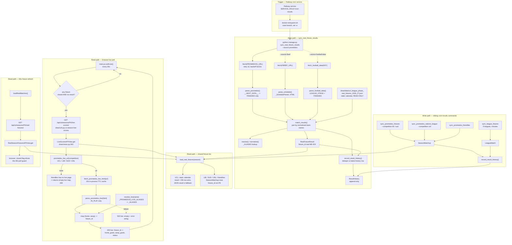
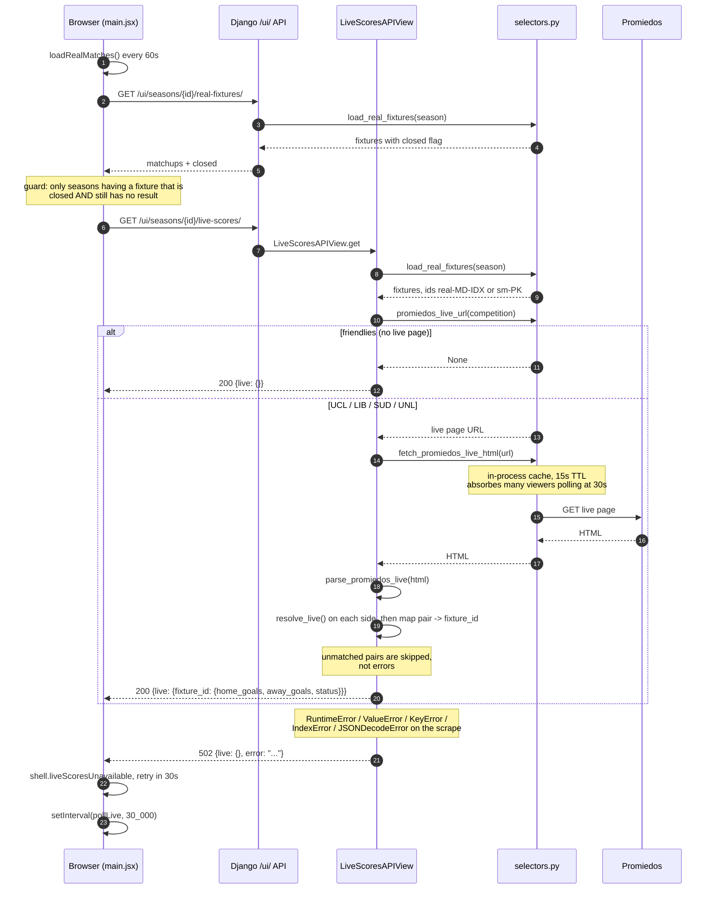

# Live Results Flow

How real match results reach the UI. There are **two independent paths** and they
do not call each other:

1. **Write path (cron)** — a Railway cron service pulls results and persists them.
   Triggered by the container entrypoint, not by a request.
2. **Read path (live poll)** — the browser polls an API endpoint that scrapes the
   Promiedos live page on demand. Reads only; never writes.

The two paths meet at the database (`RealFixtureResult` / `SeasonMatchup`), which
the read path loads as its fixture list.

---

## 1. Full flow



---

## 2. Live poll — the actual runtime sequence

This is the path a user triggers by opening the app while a match is in play.



---

## 3. Where the two paths diverge per competition

| Competition | Fixture source (read) | Fixture id | Live page | Cron writer |
|---|---|---|---|---|
| UCL | static calendar JSON + `RealFixtureResult` | `real-{matchday}-{index}` | Promiedos UCL | `sync_real_fixture_results` |
| LIB | `SeasonMatchup` | `sm-{pk}` | Promiedos Libertadores | `sync_promiedos_fixtures --competition lib` |
| SUD | `SeasonMatchup` | `sm-{pk}` | Promiedos Sudamericana | `sync_promiedos_fixtures --competition sud` |
| UNL | `SeasonMatchup` | `sm-{pk}` | Promiedos Nations League | `sync_promiedos_nations_league --competition unl` |
| Friendlies | `SeasonMatchup` | `sm-{pk}` | none — returns empty | `sync_promiedos_friendlies` |
| 9 other leagues | `LeagueMatch` | `lm-{match_id}` | none — `season_id` is null | `sync_league_fixtures` |

---

## 4. Invariants worth not breaking

- **DB result wins over the checked-in JSON.** `load_real_fixtures` sets
  `result = db_results.get(fid) or fixture.get('result')`. Railway's filesystem is
  ephemeral, so the JSON is only the static calendar; a result that only ever
  reached the JSON would vanish on redeploy.
- **`closed` is kickoff-based, not status-based.** Derived as
  `now >= kickoff - 10 minutes`. Deriving it from `FINISHED` made an in-play match
  look open, so the poll never started and live scores never appeared.
- **The live poll is gated on `closed AND no result`.** Without that gate the
  client would hammer Promiedos for competitions that are finished or have no
  live source.
- **Homepage league rows carry `season_id: null` on purpose.** `HomepageMatchesAPIView`
  serves `LeagueMatch` rows as `lm-{match_id}` with a null `season_id`, so the
  client's `.filter(Boolean)` drops them from the live poll. The 9 non-UCL leagues
  are refreshed by the 60s `loadRealMatches` call and the cron, never by the 30s
  live scrape. Setting a real `season_id` on those rows would silently route them
  into the Promiedos live path.
- **`sync_real_fixture_results` reads the fixtures JSON, never writes it.** Its
  contract is `RealFixtureResult` + `ResultHistory` only.
- **`--source promiedos` is the default** because football-data lags on `FINISHED`.
  `football-data` remains available for the live product only via manual run.
- **`set -e` in `docker-entrypoint.sh` is load-bearing.** A failed sync must exit
  non-zero so the cron run is visibly failed rather than silently "succeeding".
- **The `SERVICE_ROLE` case branch exists to fix a real Railway bug.** Railway
  builds the Dockerfile for every service and ignores per-service `startCommand`,
  so one image is branched at runtime. Do not collapse it back to a single `CMD`.

## 5. Known open tension

`docker-entrypoint.sh` records an unresolved placement question: the Nations
League sync lives on the daily `cron-leagues` job even though its *results* change
as fast as the UCL's. The comment says group by change rate, not by the word
"league" — and that a UNL result-refresh path would belong in `cron-results`. The
tension is documented in the script, not resolved.

---

## 6. Rendered output

The Mermaid blocks above are rendered and kept alongside this file:

- `live-results-full-flow.svg` — the full two-path flow (section 1)
- `live-results-poll-sequence.svg` — the live poll sequence (section 2)

Open either in a browser, VS Code, or Obsidian. SVG scales cleanly and stays
editable as text.

### Regenerating

Uses the system Chrome, so Puppeteer does not download its own ~300 MB Chromium:

```powershell
$env:PUPPETEER_SKIP_DOWNLOAD="true"
$env:PUPPETEER_EXECUTABLE_PATH="C:\Program Files\Google\Chrome\Application\chrome.exe"
npx -y @mermaid-js/mermaid-cli -i docs\live-results-flow.md -o docs\live-results-flow.rendered.md
```

Then rename the numbered outputs, since `mmdc` names them after the input file:

```powershell
Move-Item -Force docs\live-results-flow.rendered-1.svg docs\live-results-full-flow.svg
Move-Item -Force docs\live-results-flow.rendered-2.svg docs\live-results-poll-sequence.svg
Remove-Item -Force docs\live-results-flow.rendered.md
```

The output order matches the order of the ```mermaid blocks in this file.

